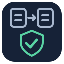

<p align="center"></p>

# CursorProof

[](https://pypi.org/project/cursorproof/)
[](https://github.com/0then0/cursorproof/blob/main/pyproject.toml)
[](https://github.com/0then0/cursorproof/actions/workflows/ci.yml)
[](https://github.com/0then0/cursorproof/blob/main/LICENSE)

CursorProof is a command-line tool for checking cursor pagination in REST APIs.
It traverses an endpoint at several page sizes, checks duplicates, ordering and
termination, and saves a trace that can be replayed without the API.

An API can return `200 OK` on every page while skipping records or repeating a
page. An independent oracle, such as an unpaginated endpoint or database query,
lets CursorProof compare the returned stream with the expected records.

## Install

Requires Python 3.10 or newer.

```sh
pipx install cursorproof
# or
python -m pip install cursorproof
```

## Check your API

Save a configuration as `cursorproof.yml`. This example expects `results` and
`next_cursor` in each response and records identified by `id`:

```yaml
url: http://localhost:8000/api/orders
response:
  items: $.results
  next_cursor: $.next_cursor
  id: $.id
ordering:
  - field: id
    type: number
limits: [10, 50, 100]
```

Validate the configuration, run the checks, and replay the saved trace:

```sh
cursorproof check cursorproof.yml
cursorproof run cursorproof.yml
cursorproof replay cursorproof-repro.json
```

Token pagination is the default: the next request sends the returned token in
the `cursor` query parameter and the selected page size in `limit`.
For APIs that return a continuation URL, including Django REST framework, add:

```yaml
pagination:
  mode: url
  cursor_param: cursor
  limit_param: page_size
response:
  items: $.results
  next_cursor: $.next
  id: $.id
```

URL mode requires CursorProof 0.2.0 or newer. To install the version from a
checkout, run `uv tool install .` from the repository root.

URL mode follows server-provided links after checking the origin, endpoint,
scope parameters and page size. It does not follow redirects. The
[user guide](https://github.com/0then0/cursorproof/blob/main/docs/guide.md)
explains authentication, response paths, ordering, oracles and the
[continuation URL contract](https://github.com/0then0/cursorproof/blob/main/docs/guide.md#continuation-urls).

When the next URL is only in the HTTP `Link` header, as in the Distribution
Registry or GitLab keyset pagination, select that source instead of a JSON path
(CursorProof 0.4.0 or newer):

```yaml
pagination:
  mode: url
  continuation: link-header
  cursor_param: last
  limit_param: n
response:
  items: $.tags
  id: $
```

The `rel="next"` target goes through the same URL checks. A malformed, ambiguous
or anchored `next` link is an error, not the last page. See the
[Link header guide](https://github.com/0then0/cursorproof/blob/main/docs/guide.md#link-header-continuation),
the [Registry example](https://github.com/0then0/cursorproof/blob/main/examples/registry-tags.yml)
and its [validation against a real registry](https://github.com/0then0/cursorproof/blob/main/docs/registry-tags.md).

## Try the local demo

Clone the [repository](https://github.com/0then0/cursorproof) and run these
commands from its root directory.

Install from the checkout with [uv](https://docs.astral.sh/uv/):

```sh
uv sync --locked
```

To install the checkout as an isolated CLI tool instead, run `uv tool install .`.

Start the demo API in one terminal:

```sh
uv run python examples/demo_api.py
```

In another terminal, run the broken example:

```sh
uv run cursorproof run examples/broken.yml
```

Replay its saved trace offline with:

```sh
uv run cursorproof replay cursorproof-repro.json
```

The demo has 40 records with repeated sort values. `/broken` continues using only
the timestamp and skips records at page boundaries despite successful responses.
CursorProof reports `CP003 MISSING_ITEMS` and differences between limits. The
`/correct` endpoint also uses the unique ID; try it with:

```sh
uv run cursorproof run examples/correct.yml --format json --repro correct-repro.json
```

## Understand the result

- Exit `0`: all executed checks passed.
- Exit `1`: CursorProof found a pagination invariant violation.
- Exit `2`: configuration or execution failed, or a traversal could not finish.

Use `--format json` for a machine-readable report and `--repro PATH` to choose
the trace file. A passing run describes the tested data and configuration.
Without an oracle, it cannot establish completeness: every tested page size
could omit the same records. See the guide for
[oracle configuration](https://github.com/0then0/cursorproof/blob/main/docs/guide.md#oracle),
[finding codes](https://github.com/0then0/cursorproof/blob/main/docs/guide.md#findings-and-exit-codes)
and [trace privacy](https://github.com/0then0/cursorproof/blob/main/docs/guide.md#reproduction-and-privacy).

## POST pagination with a JSON body

For APIs that page with `POST`, such as Qdrant Scroll, set `method: POST` and a
`body`. CursorProof adds the page size and cursor as top-level body fields, keeps
every other field unchanged and sends integer or string cursors with their original
JSON type. See the
[POST body guide](https://github.com/0then0/cursorproof/blob/main/docs/guide.md#post-pagination-with-a-json-body),
the [Qdrant example](https://github.com/0then0/cursorproof/blob/main/examples/qdrant-scroll.yml)
and its [validation against a real Qdrant](https://github.com/0then0/cursorproof/blob/main/docs/qdrant-scroll.md).

## Django REST framework example

The [DRF configuration](https://github.com/0then0/cursorproof/blob/main/examples/drf.yml)
uses standard `CursorPagination` links. The
[Django REST framework example](https://github.com/0then0/cursorproof/blob/main/docs/drf-regression.md)
shows how a large group of equal sort values can repeat a page. It includes a
local HTTP/SQLite setup, a unique-ordering control and traces you can replay
without Django.

## EmDash plugin storage example

The [EmDash example](https://github.com/0then0/cursorproof/blob/main/docs/emdash-2691.md)
is a historical check against a TypeScript target. It runs EmDash's real
`PluginStorageRepository` before and after the fix for
[issue #2691](https://github.com/emdash-cms/emdash/issues/2691) behind a thin
test wrapper, compares the stream with an independent database oracle and saves
traces you can replay without Node.js. It is not a claim about current EmDash.

## Additional checks

CursorProof also supports snapshot consistency, live keyset checks, mutation
hooks, cardinality boundary tests and cursor binding probes. Mutation hooks and
boundary tests execute commands supplied in your configuration and can change
data. Use controlled test environments and read the
[consistency and mutation documentation](https://github.com/0then0/cursorproof/blob/main/docs/guide.md#consistency-and-mutation-hooks)
before enabling them. URL mode does not support boundary tests or cursor binding
probes. POST mode supports query-parameter binding probes.

Run `cursorproof --help` or `cursorproof COMMAND --help` for command options.

## Development

```sh
uv sync --locked
uv run pytest
uv run ruff check .
uv run ruff format --check .
uv run mypy
uv build
```

The analyzer checks recorded observations without network I/O. The runner makes
requests, and the CLI displays reports. Tests use HTTPX transports, Hypothesis
and the local demo API.

The optional locked `integration` group adds Django/DRF for tests against a real
HTTP endpoint. Follow the
[integration instructions](https://github.com/0then0/cursorproof/blob/main/docs/drf-regression.md#run-the-example)
to use a separate environment and the built wheel. CI runs the core checks
on Python 3.10 through 3.15. The Django/DRF integration tests require
Python 3.12 or newer and run on Python 3.12 through 3.15.

## Contributing and support

See [Contributing](https://github.com/0then0/cursorproof/blob/main/CONTRIBUTING.md)
for setup, checks and pull request guidance. Use
[issues](https://github.com/0then0/cursorproof/issues) for bugs and feature requests,
and follow the [code of conduct](https://github.com/0then0/cursorproof/blob/main/CODE_OF_CONDUCT.md).
Report vulnerabilities privately using the
[security policy](https://github.com/0then0/cursorproof/blob/main/SECURITY.md).

Release history is in the
[changelog](https://github.com/0then0/cursorproof/blob/main/CHANGELOG.md).
CursorProof is licensed under
[Apache-2.0](https://github.com/0then0/cursorproof/blob/main/LICENSE).
